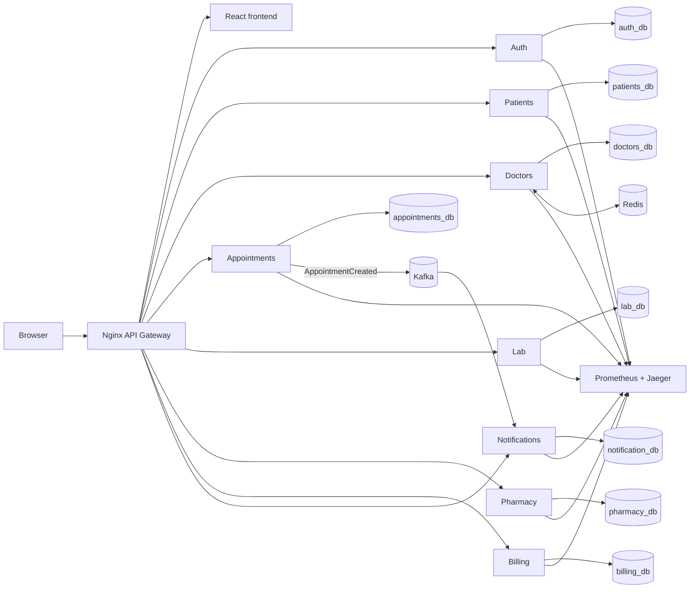

# PulseCore Hospital Management System

[](https://github.com/Beder-asu/pulse-core/actions/workflows/ci.yml)

PulseCore is a production-style hospital management system built as a Docker-orchestrated microservice application. It covers the main operational flows of a small medical system: admissions, patient records, appointment booking, lab work, prescriptions, dispensing, billing, notifications, and role-scoped dashboards.

The project is intentionally more than a CRUD demo. It demonstrates how frontend, gateway, authentication, service-owned databases, asynchronous messaging, caching, and observability fit together in one working local stack.

> **Deployment scope:** PulseCore is a local reference architecture, not a hosted medical product. Keeping eight application services plus PostgreSQL, Kafka, Redis, and the observability stack permanently online would add recurring infrastructure cost without strengthening the engineering evidence. The repository therefore prioritizes reproducible Docker startup, automated verification, and an inspectable end-to-end demo path.

## What This Project Demonstrates

- **Microservice boundaries:** Each domain is owned by a separate Express service with its own Prisma schema and PostgreSQL database.
- **Gateway-first access:** Browser traffic enters through Nginx at `http://localhost`; API routes are proxied to the owning service.
- **Role-scoped security:** JWT access tokens are verified on every protected request, and services apply role/ownership rules before querying data.
- **Refresh-token sessions:** Login issues a short-lived access JWT plus a rotating HttpOnly refresh cookie backed by hashed refresh-token records.
- **Event-driven behavior:** Appointments publish Kafka events and notifications consume them asynchronously.
- **Cache-aside Redis:** Doctor directory/profile reads use Redis as an optional acceleration layer while PostgreSQL remains authoritative.
- **Observability:** Services export metrics to Prometheus and traces to Jaeger. Grafana provisions dashboards over Prometheus and Loki.

## Architecture

This project utilizes a microservices architecture to ensure domain isolation and independent scalability. The system is composed of the following core components:

*   **API Gateway:** Nginx handles request routing and centralized CORS policy.
*   **Microservices:** 8 Node.js (Express) services handling specific domains (Auth, Patients, Doctors, Appointments, Lab, Pharmacy, Billing, Notifications). HTTP controllers delegate to use-case services, policy modules, and Prisma repositories.
*   **Databases:** PostgreSQL 16. Each service maintains an isolated database managed by Prisma. All persisted identifiers use native PostgreSQL UUID columns, and table IDs default to UUIDv7.
*   **Message Broker:** Apache Kafka (KRaft mode) for asynchronous, event-driven communication between services.
*   **Redis:** Redis provides optional cache-aside acceleration for doctor directory/profile reads. PostgreSQL remains the source of truth, and cache failures fall back to the database.
*   **Frontend:** React Single Page Application built with Vite and styled with plain CSS (glassmorphism aesthetic).
*   **Observability Stack:** OpenTelemetry exports traces to Jaeger, Prometheus collects service metrics, and Grafana provisions metrics dashboards. Loki is provisioned, but application log shipping is opt-in and not yet fully verified.

## Directory Structure

*   `/services`: Contains the 8 Node.js microservices.
*   `/packages/common`: Shared internal npm library for middlewares, database clients, and loggers.
*   `/frontend`: The React Vite application.
*   `/nginx`: API Gateway configuration.
*   `/monitoring`: Configurations for the observability stack (OTel, Prometheus, Grafana, etc.).
*   `/docs`: Detailed architectural and design documentation.

## Runtime Map



## Verification

The clean-checkout verification path covers:

| Check | Current evidence |
| --- | --- |
| Backend and shared policy/service behavior | 40 passing Node assertions across 13 test files |
| Frontend identity behavior | 2 passing Node assertions |
| Frontend quality gate | Oxlint and production Vite build pass |
| Compose definition | Parsed and validated without starting paid infrastructure |
| Production dependency audit | 0 vulnerabilities in both backend and frontend production dependency sets |
| Full local workflow | Gateway script covers health, authentication, patient creation, appointments, lab, pharmacy, billing, persistence, and Kafka-backed notifications |
| Security workflow | Role scoping, forged internal headers, refresh rotation, replay revocation, and logout |

GitHub Actions runs the backend tests, frontend tests/lint/build, and Compose validation on every push and pull request. The full gateway and security workflows require the local Docker stack and intentionally remain operator-run integration checks.

## Getting Started

### Prerequisites
*   Docker and Docker Compose
*   Node.js v22 (for local development/testing)

### Running the System

Create a local `.env` file first:

```bash
cp .env.example .env
```

Fill the placeholders with local-only values. The entire infrastructure can then be spun up using Docker Compose:

```bash
docker compose up --build -d
```

On a fresh Docker volume, Postgres creates all service databases and the `db-setup` job pushes Prisma schemas and seeds demo data before the app services start. `db-setup` is expected to show `Exited (0)` after it finishes; it is an initialization job, not a long-running server. Once running, the production frontend is available at `http://localhost`, with API services behind the same Nginx gateway at `http://localhost/api/*`.

Before each schema push, `db-setup` installs the PostgreSQL `uuid_generate_v7()` function in that service database. Seed records use fixed UUIDv7 values so references remain coherent across the otherwise isolated databases. New database rows and application-generated Kafka event IDs also use UUIDv7.

### Verify a Clean Checkout

Install both lockfiles, then run the portable verification command:

```bash
npm ci
npm ci --prefix frontend
npm run verify
```

`npm test` generates the correct Prisma client before each service test group. This avoids relying on generated files or a developer's previous local state.

With the Docker stack running, verify the complete gateway and security flows:

```bash
npm run test:e2e
npm run test:security
```

### Observability Ports
- **Grafana:** `http://localhost:3000` (uses the local Grafana credentials configured in Compose)
- **Prometheus:** `http://localhost:9090`
- **Jaeger UI:** `http://localhost:16686`
- **Loki:** `http://localhost:3100`

Grafana currently provisions Prometheus and Loki data sources. Jaeger is visited directly through its own UI. Loki is available, but application log shipping is opt-in through `ENABLE_LOKI_LOGGING=true`; Docker container logs remain the verified logging path.

### Development Authentication
The frontend signs in through the Auth service. It stores the short-lived access JWT for API authorization, while the 30-day rotating refresh token is kept in an HttpOnly cookie and persisted by the Auth service only as a SHA-256 hash. After seeding, these demo accounts are available. The local demo password is configured in the seed file and should be changed before any shared or hosted deployment.

```text
admin@hospital.com
doctor@hospital.com
salma.doctor@hospital.com
staff@hospital.com
patient@hospital.com
mariam.patient@hospital.com
youssef.patient@hospital.com
```

The demo data includes three patient profiles, two doctors, scheduled and completed appointments, pending and completed lab work, pharmacy inventory and prescriptions, issued and paid invoices, and notifications connected by the same user UUIDs.

### Destructive Database Reset

The following PowerShell procedure permanently deletes all application data and recreates the eight service databases. Stop the application services first, run the reset SQL against the Postgres container, then rerun the one-shot setup job:

```powershell
docker compose stop auth-service patients-service doctors-service appointments-service lab-service pharmacy-service billing-service notification-service api-gateway
$sql = Get-Content -Raw .\scripts\reset-databases.sql
docker exec pulsecore-postgres psql -v ON_ERROR_STOP=1 -U postgres -d postgres -c $sql
docker compose run --rm db-setup
docker compose up -d
```

Use `scripts/verify-uuidv7.sql` after migration or runtime testing to audit every populated UUID column and every table ID default.

The common auth middleware still supports `Bearer dummy-dev-token-xyz` only when `ENABLE_DEV_AUTH_BYPASS=true` is explicitly configured.

The Doctors service caches `GET /api/doctors` and `GET /api/doctors/:id` results in Redis for 300 seconds by default. Creating a doctor profile invalidates the directory key and warms both profile-ID and user-ID keys. Configure this with `REDIS_URL`, `DOCTOR_LIST_CACHE_TTL_SECONDS`, and `DOCTOR_PROFILE_CACHE_TTL_SECONDS`. Cache operation outcomes are exported as `pulsecore_cache_operations_total` on the service's `/metrics` endpoint.

Every protected request verifies an access JWT. Endpoint guards reject disallowed roles, and service-local policies add ownership filters directly to Prisma queries. Patients can access only their own clinical records and appointments; doctors are scoped to assigned or authored work; staff and administrators receive the operational access described in `docs/security-access.md`. Public Nginx traffic cannot impersonate an internal service because Nginx clears the internal authentication headers before proxying.

### Local Frontend Development

To run the React frontend locally:

```bash
cd frontend
npm install
npm run dev
```

The frontend will be available at `http://localhost:5173`.

## Documentation

For deep dives into specific areas of the system, refer to the `/docs` directory:
*   `architecture.md`: Detailed system design and microservice boundaries.
*   `api-design.md`: Gateway routing, authentication, persistence, and current service communication.
*   `api-endpoints.md`: Working API endpoints currently available.
*   `security-access.md`: Role matrix, JWT refresh lifecycle, internal-call protection, and SOLID boundaries.
*   `srp-refactor-log.md`: Service-by-service responsibility refactor and verification record.
*   `portfolio-demo.md`: Presentation-ready architecture story, demo path, URLs, and honest limitations.
*   `frontend-design.md`: UI/UX decisions, tech stack, and component structure.
*   `troubleshooting-history.md`: Errors encountered, root causes, resolutions, verification status, and remaining gaps.

Final-configuration learning notes live in `/tutorials`:
*   `docker_compose_guide.md`: Current Compose services, volumes, ports, and startup order.
*   `docker_phase_2.md`: Final gateway, Redis, and Kafka wiring.
*   `docker_phase_3.md`: Final service image, frontend image, migration image, and Docker ignore patterns.
*   `nginx_api_gateway_tutorial.md` and `nginx_configuration.md`: Current gateway routing, proxy headers, CORS, DNS, and SPA forwarding.
*   `kafka_tutorial.md`: Current `AppointmentCreated` publisher and notification consumer flow.
*   `redis_caching_tutorial.md`: Current Redis cache-aside lifecycle for doctor reads.
*   `prometheus_tutorial.md`, `opentelemetry_tutorial.md`, and `loki_tutorial.md`: Current metrics, tracing, Grafana, Jaeger, and conservative Loki status.
